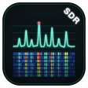
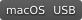
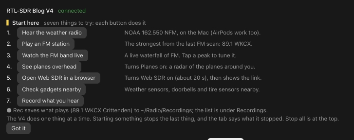
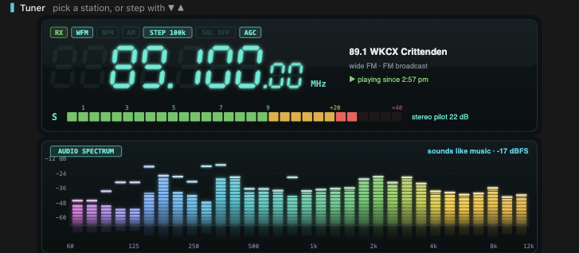
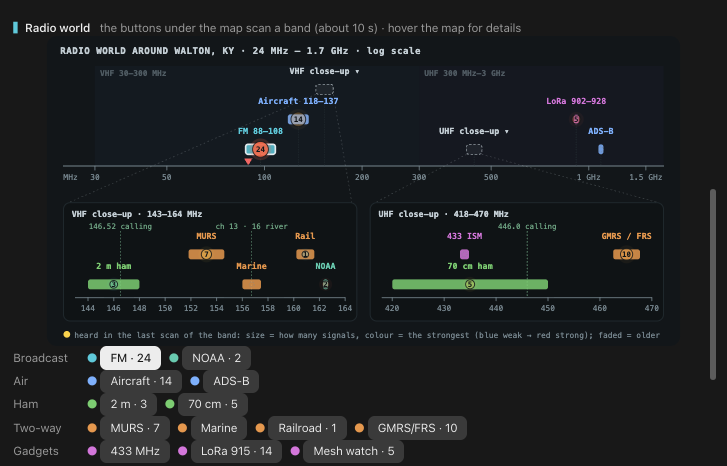
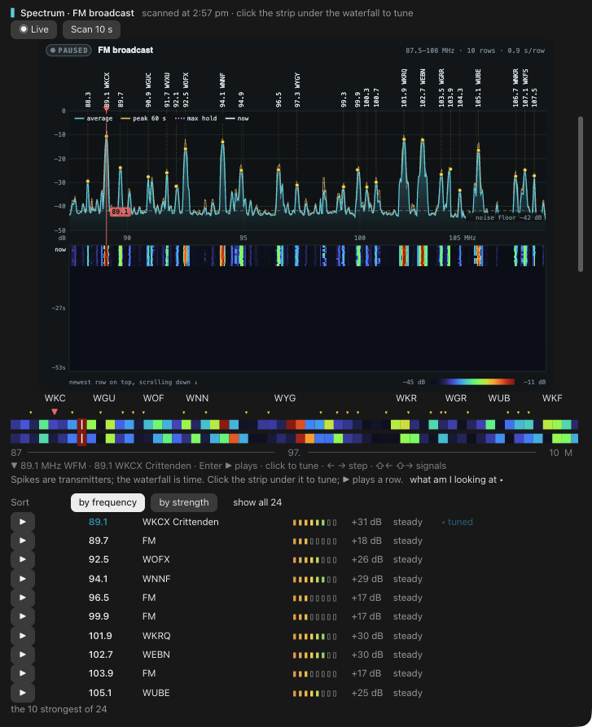
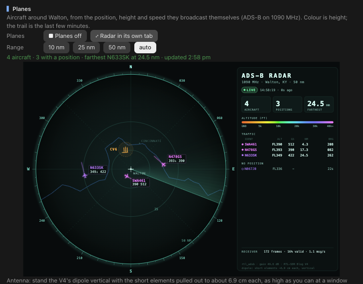
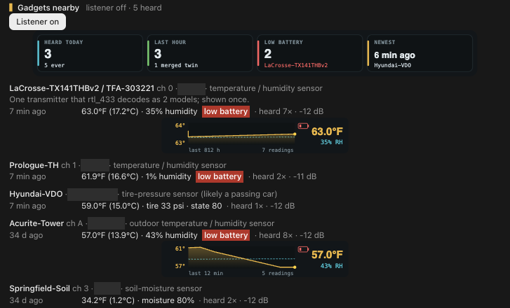

<div align="center">


</div>

<div align="center">



</div>

<h1 align="center">rtl-sdr-tab</h1>

<p align="center">
  <b>A Radio tab for Claude Code.</b><br>
  Plug an RTL-SDR Blog V4 into your Mac, type <code>/sdr</code>, and hear and see the radio world around you: FM and weather radio, the planes overhead, ham stations, weather alerts and the little sensors on your street.
</p>

<div align="center">

   [](LICENSE)

</div>

The RTL-SDR Blog V4 is a small USB dongle that can hear almost everything from shortwave up to 1.7 GHz. I wanted it to be one instrument, right beside my code, that explains what it hears while I use it. So I built this tab. It only receives; nothing here transmits.

Out of the box it's set up for my station in Walton, Kentucky. A small location file moves it to yours.

## Install

In Claude Code 2.1.275 or later, type:

```
/plugin install wildcat-radio --marketplace RedThoroughbred/rtl-sdr-tab
```

In the Claude desktop app, `/plugin` opens the app's own plugin settings instead, so run this in a terminal:

```
claude plugin install wildcat-radio --marketplace RedThoroughbred/rtl-sdr-tab
```

In a session that's already open, run `/reload-plugins`. Plug in the V4 and type `/sdr`. (Claude Code has its own `/radio`, so this tab's command is `/sdr`.)

## What you need

- **A Mac** with an **RTL-SDR Blog V4** on USB.
- **The rtl-sdr tools from Homebrew:** `brew install librtlsdr rtl_433`, plus `sox` or `ffmpeg` for audio.
- **Python 3.** The scripts use the standard library only.
- **Docker Desktop,** only for the Web SDR.
- **Your location.** Walton, KY is built in. Put your own in `~/Library/Application Support/radio/location.json` ([how](docs/details.md#your-location)).
- **An antenna that suits the band.** The V4 kit's dipole covers most of it, and the tab says how far to pull the elements out for planes and for APRS.

## A tour

### Start here and the tuner

<div align="center">



</div>

Seven buttons that each do one thing: hear the weather radio, play an FM station, watch the FM band live, see the planes overhead, open the Web SDR, check the gadgets nearby, and record what you hear. The V4 does one thing at a time, and the tab always says what it's doing.

<div align="center">



</div>

A receiver-style tuner with an S-meter and, under it, a spectrum of the sound itself. WFM, NFM, AM, USB, LSB and CW, station tabs, favourites, ● Rec, and a log that saves each transmission as a clip.

### The radio world around you

<div align="center">



</div>

A band map from 24 MHz to 1.7 GHz that shows what each band's last scan heard, with close-ups of VHF and UHF. Each button under it scans that band in about ten seconds.

### The FM band, live

<div align="center">



</div>

Every station labelled on a spectrum, a scrolling waterfall under it, and the station list. Click the strip under the waterfall to tune there.

### Planes overhead

<div align="center">



</div>

A radar of the aircraft around you, from the ADS-B broadcasts they send on 1090 MHz: each flight's altitude, speed and the trail of its last few minutes, coloured by height.

### Gadgets nearby

<div align="center">



</div>

Everything `rtl_433` hears on 433.92 MHz: weather stations, soil sensors, doorbells, and even the tire-pressure sensors in passing cars, with sparklines of their readings. I covered the sensor IDs in this picture. A tire sensor's ID never changes, so it can identify a car.

### And more

- **APRS:** ham stations' positions, weather and messages on 144.390 MHz, on a map.
- **Weather alerts:** the coded NOAA alerts (SAME) from your weather radio station, decoded.
- **Web SDR:** OpenWebRX+ in Docker, a full waterfall in any browser, your phone included, with a button that hands the frequency back to the tab.
- **Scanner:** favourite channels cycled with squelch, with lock-out, hold and a priority channel.
- **Recordings and IQ snapshots:** clips of what you heard, and raw I/Q you can replay as a waterfall.
- **HF:** shortwave through the V4's built-in upconverter, once a long-wire antenna is on it.
- **Share to phone:** an SDR app on your phone can use the V4 over your network while you share.

## Ask Claude

Version 0.6.0 lets Claude use the radio too. Six tools and a skill come with the plugin, so you can just talk:

- "What am I hearing right now?" Claude checks the tab, scans a band if it needs to, and tells you what the signals are.
- "What planes are overhead?" Claude reads the aircraft from the last ADS-B data: flight, altitude, speed, and how far away and which way.
- "Play the weather radio" or "tune 121.5 AM". Claude plays it on the Mac's speakers and says if the signal is weak.

Claude can read the tab's status, the planes and the gadgets, scan a band, listen to a frequency or a station by name, and switch Planes, APRS, the weather-alert watch and the gadget listener on or off. The `radio-guide` skill teaches it what lives where on the dial, how to find out what a signal is, and the manners of a receiver. [The details](docs/details.md#tools-for-claude) list every tool.

> [!WARNING]
> This only ever receives. Nothing Claude does here transmits. Web SDR, sharing to a phone, the bias-tee, settings, the HF test and deleting recordings stay in the tab; Claude will say to do those there. Starting a scan, a tune or a job takes the V4 and stops whatever was running, just like the tab's buttons.

## What's new in 0.7.0

- **Renamed for Anthropic's plugin directory:** the plugin is now `wildcat-radio` (shown as Wildcat Radio). The `/sdr` command works as before. If you installed it under the old name, run `claude plugin uninstall radio@rtl-sdr-tab`, then the new install line above, then `/reload-plugins`. Your location, recordings and settings files stay; a few tab preferences, such as colours and toggles, start fresh.

## What's new in 0.6.0

- **Tools for Claude:** `sdr_status`, `sdr_planes`, `sdr_gadgets`, `sdr_scan`, `sdr_tune` and `sdr_job`.
- **The `radio-guide` skill:** teaches Claude the bands, "what am I hearing?", planes, APRS and alerts, and receive-only manners.
- A tool press and a click on the tab share one queue, so they never collide. Sensor IDs never leave the tab.

## Updating

```
claude plugin marketplace update rtl-sdr-tab
claude plugin update wildcat-radio@rtl-sdr-tab
```

Then run `/reload-plugins` in a session that's already open.

## How it works

- The tab drives the Homebrew rtl-sdr tools (`rtl_fm`, `rtl_power`, `rtl_adsb`, `rtl_433`, `rtl_tcp`) through small standard-library Python scripts.
- The V4 does one thing at a time. Starting something stops the last thing, and the tab says what it stopped.
- Every button answers on the first click and says what it's doing.
- It only receives. Nothing here transmits.

[The details](docs/details.md) cover every section, command and file, and how to set your location.

## What it runs and sends

- **Programs it starts:** `python3` on the plugin's own scripts (`scripts/radio.py`, `adsb.py`, `digital.py`, `location.py`, all standard library only), and from them the Homebrew tools: `rtl_fm`, `rtl_power`, `rtl_adsb`, `rtl_sdr`, `rtl_tcp`, `rtl_biast` and `rtl_433`, plus `ffmpeg` (recording, and `ffplay` to play it back) and `play` or `ffplay` to put the audio on the speakers. The ADS-B, APRS and weather-alert (SAME) decoders are the scripts' own Python code (`multimon-ng` is used for APRS if you have installed it). Web SDR also runs `docker`. `/usr/bin/open` shows a recording in Finder and starts Docker Desktop for Web SDR. Nothing is installed for you.
- **It only receives.** Nothing here transmits. Jobs run only while you or Claude turn them on, and the V4 does one thing at a time.
- **Files it writes:** state, the latest scans, the aircraft, APRS and alert history and the gadget log in `~/Library/Application Support/radio`; a lock and the Web SDR pids and logs in `~/Library/Caches/radio`; recordings and clips in `~/Radio/Recordings` and IQ snapshots in `~/Radio/IQ`; and Web SDR's settings, bookmarks and user list in `~/Library/Application Support/radio/openwebrx` (unless you point it elsewhere). Old recordings are pruned by the caps in the settings. Gadget sensor IDs stay on your Mac and are never shown to Claude.
- **Network ports, only when you ask:**
  - **Share to phone** starts `rtl_tcp` on port 1234. By default it listens on all of the Mac's network addresses (the home Wi-Fi and Tailscale if present), and `rtl_tcp` has no password, so anyone who can reach that address can use the V4 until you press Stop. The tab can also limit it to the LAN or to Tailscale.
  - **Web SDR** runs OpenWebRX+ in Docker. When you start it, Docker pulls the pinned image `slechev/openwebrxplus:1.2.126` (from Docker Hub) if it isn't on the Mac yet, and starts Docker Desktop if it is not running. The V4 stays on the Mac: `rtl_tcp` is bound to 127.0.0.1:1234 only. The Web SDR page is on port 8073 at 127.0.0.1 and at the Mac's LAN address, so other devices on your network can open it; a small "send to Radio tab" endpoint on port 8074 listens on the same addresses. The admin password is made on first start and kept in the macOS Keychain (item `openwebrx-wildcat`). The tab shows the `tailscale serve` command for reaching it away from home but does not run it.
  - Otherwise nothing listens, and nothing is opened to the internet.
- **Nothing is sent to any server by the plugin itself.** The scripts make no web requests (the only one is a local check that the Web SDR page is up, on 127.0.0.1). Radio data is read off the air on your own antenna. What Claude reads through the six tools becomes part of your conversation like any other tool result; gadget sensor IDs are never included.

## Wildcat RF

rtl-sdr-tab is part of Wildcat RF, the radio instruments I build for Claude Code. Its sibling is [nanovna-tab](https://github.com/RedThoroughbred/nanovna-tab) (the `wildcat-vna` plugin, Wildcat VNA), a NanoVNA tab for tuning and testing antennas, in the same instrument look.

I built it with Claude Code as my coding partner.

## License

MIT. See [LICENSE](LICENSE). An independent project, not affiliated with RTL-SDR Blog, OpenWebRX+ or the makers of the devices it hears.
