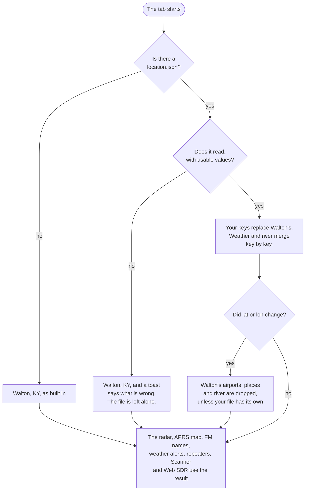
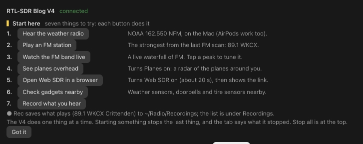
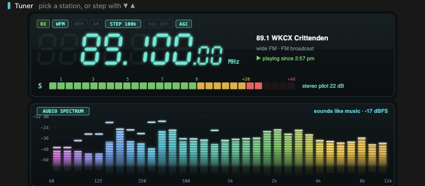
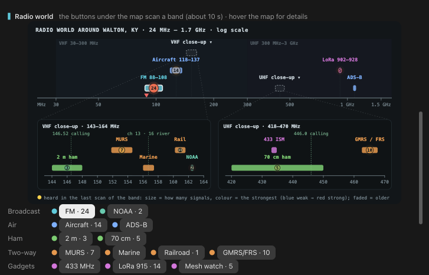
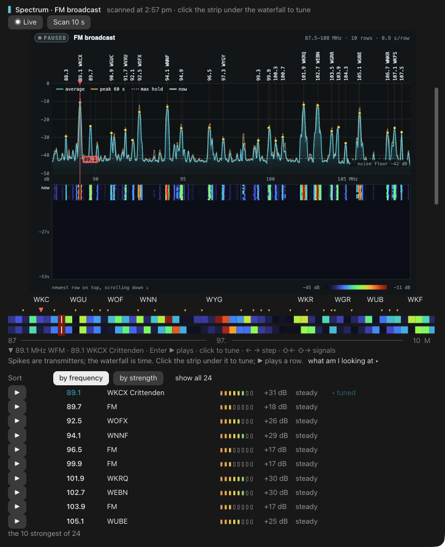
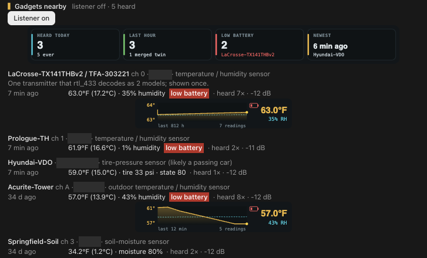
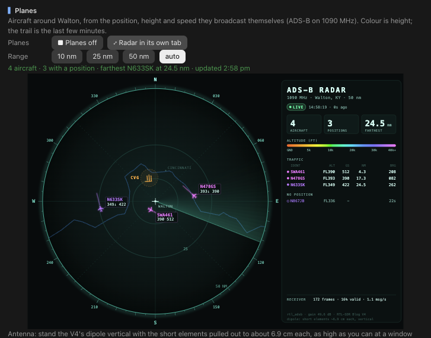
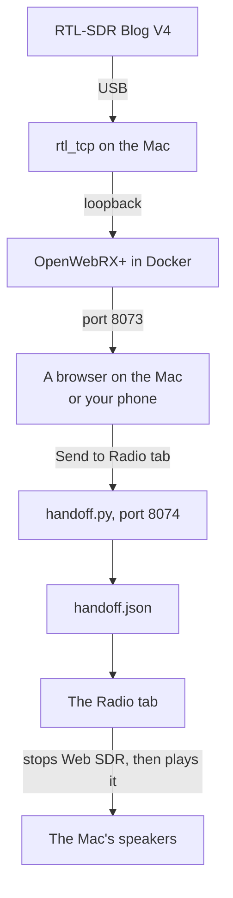
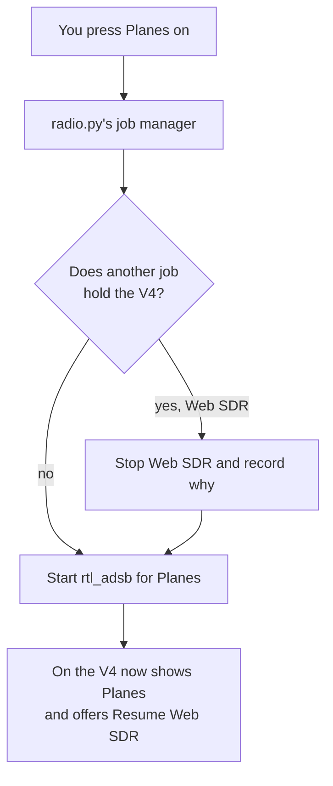
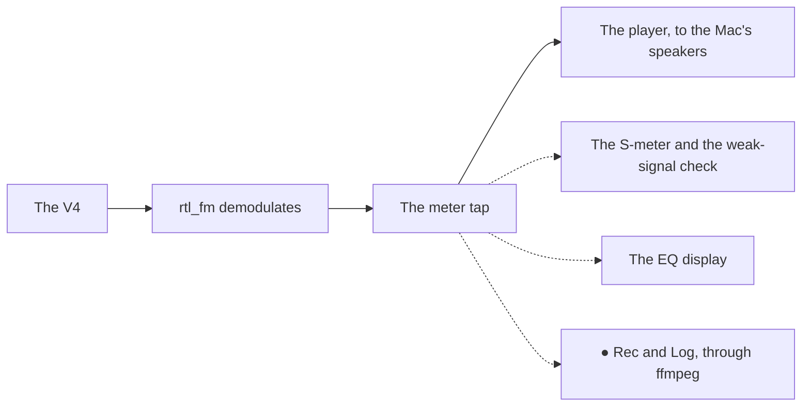

# rtl-sdr-tab: the details

Everything the Radio tab does, section by section, with every command and file, and how to move it to where you live.

New here? Start with the [README](../README.md): it has the pictures, the install line and what you need.

**On this page**

- [First run](#first-run) and [your location](#your-location)
- The tab, top to bottom: [Start here](#start-here-and-on-the-v4-now) · [Tuner](#tuner) · [Radio world](#radio-world) · [Spectrum](#spectrum-and-the-tuning-strip) · [Mesh traffic](#mesh-traffic) · [Gadgets](#gadgets-nearby) · [Share to phone](#share-to-phone) · [Scanner](#scanner) · [Recordings](#recordings) · [IQ snapshots](#iq-snapshots) · [Planes](#planes) · [APRS](#aprs) · [Weather alerts](#weather-alerts) · [Web SDR](#web-sdr) · [Radio settings](#radio-settings) · [Status line](#the-status-line)
- [Tools for Claude](#tools-for-claude)
- [Commands](#commands)
- [How it works](#how-it-works)
- [Files](#files)
- [Tests](#tests)

## First run

From a fresh install to sound on the Mac's speakers.

1. **Install the tools** from Homebrew: `brew install librtlsdr rtl_433`, plus `sox` or `ffmpeg` for audio. ● Rec, Log and playing recordings back use `ffmpeg`. Web SDR also needs Docker Desktop.
2. **Plug the V4 into the Mac**, and close SDR++ or any other program that uses it.
3. **Type `/sdr`.** Claude Code has its own `/radio`, so this tab's command is `/sdr`. The tab opens with **Start here** at the top.
4. **Try a button in Start here.** Hear the weather radio is a good first one: it plays your NOAA station.

> [!IMPORTANT]
> **The V4 does one thing at a time.** Starting something stops the last thing, and the tab says what it stopped and offers **Resume**. If another program has the V4, the tab names it, and picks the V4 up within 30 s of that program closing. [How it works](#one-program-at-a-time).

The tab only receives. Nothing here transmits.

<details>
<summary>Which tool does what</summary>

| Tool | From | Used for |
|---|---|---|
| `rtl_fm` | librtlsdr | Listening, the Scanner, APRS and weather alerts |
| `rtl_power` | librtlsdr | Scans, the live view and PPM calibration |
| `rtl_tcp` | librtlsdr | Share to phone, and Web SDR |
| `rtl_adsb` | librtlsdr | Planes |
| `rtl_sdr` | librtlsdr | IQ snapshots |
| `rtl_biast` | librtlsdr | The bias-tee switch |
| `rtl_433` | rtl_433 | Gadgets nearby, and decoding 433.92 MHz snapshots |
| `play` or `ffplay` | sox or ffmpeg | Playing audio on the Mac |
| `ffmpeg` | ffmpeg | ● Rec and Log |

</details>

## Your location

Out of the box the tab is set up for my station in Walton, KY. A small file moves it to yours.

Walton sets a lot: the plane radar's centre and CVG's runways, the Cincinnati FM stations, the local repeaters, NOAA KIH42 and the county codes for weather alerts, the APRS map's place names, and the Ohio River. To move the tab, make `~/Library/Application Support/radio/location.json`, in the same folder as the rest of the tab's state (`RADIO_DIR` moves that folder). No file means Walton, exactly as built in.

> [!TIP]
> Use a town centre, not your home address. The radar and the APRS map are centred on this point.



**A file only has to hold what you want to change.** Every key you leave out keeps its Walton value, apart from the hand-drawn shapes ([below](#moving-the-centre)). Here's a complete one, for Springfield, IL, with made-up call signs and a made-up airport layout, showing every key:

```json
{
  "name": "Springfield, IL",
  "short": "Springfield",
  "lat": 39.799,
  "lon": -89.644,
  "airports": [
    {"id": "SPI", "name": "Abraham Lincoln Capital", "lat": 39.8441, "lon": -89.6779, "elevFt": 598,
     "runways": [["4/22", 0.1, 0.0, 40, 1.4]]}
  ],
  "places": [["Chatham", 39.677, -89.7027, 0, 25]],
  "radar_places": [["RIVERTON", 39.835, -89.54]],
  "river": {"name": "Sangamon River", "radar": [[39.9, -89.9], [39.85, -89.7]], "map": [[39.9, -89.9], [39.85, -89.7]]},
  "fm": {"88.5": "WXYZ Springfield", "99.1": "WABC"},
  "weather": {
    "station": "KXYZ99", "city": "Springfield", "freq": 162.475,
    "home": "17167", "local": ["17167", "17129"],
    "counties": {"17167": "Sangamon", "17129": "Menard", "17001": "Adams"}
  },
  "repeaters": [
    {"mhz": 145.23, "name": "Springfield ARC repeater", "short": "SARC", "mark": true, "wx": true}
  ],
  "scan": [[162.475, "fm", "NOAA KXYZ99"], [145.23, "fm", "SARC"], [156.8, "fm", "Marine ch 16"]]
}
```

| Key | What it does |
|---|---|
| `name` | The place as the tab writes it: titles, the radar caption, picture descriptions. The receiver is called "name (town centre)" |
| `short` | The word on the map centre ("Springfield", and "SPRINGFIELD" on the radar). Taken from `name`, up to the comma, when left out |
| `lat`, `lon` | The receiver's reference point, in degrees. Planes are measured from it, and the radar and the APRS map are centred on it |
| `airports` | Drawn on the radar with schematic runways. Each runway is `[designator, east nm, north nm, true heading of the higher end, length nm]`, measured from the airport's point. `[]` for none |
| `places` | The APRS map's place names: `[name, lat, lon, smallest map radius mi, largest map radius mi]`. The first three are labelled first |
| `radar_places` | City names on the plane radar: `[name, lat, lon]` |
| `river` | A faint river behind both pictures: its `name`, and coarse `[lat, lon]` points, west to east, for the `radar` and the APRS `map`. It also names the river in the Marine help |
| `fm` | FM broadcast stations: frequency (one decimal) to name. They name the peaks, fill the tuner's FM list before a scan, and become Web SDR bookmarks |
| `weather` | Your NOAA Weather Radio `station`, `city` and `freq` (162.400 to 162.550), and the SAME alert codes: `counties` maps a five-digit state + county code to a name, `local` lists the ones that count as yours (shown first), and `home` is your own county (tagged with `short`) |
| `repeaters` | Local repeaters, each with `mhz`, `name` and an optional chart label, `short`. `mark` also marks it on the 2 m scan, and `wx` also lists it under Weather |
| `scan` | The Scanner's starting favourites, `[MHz, mode, name]`. Used only the first time; your own `scan add` list wins after that |

Your `weather` station's frequency is the one Hear the weather radio plays, the alert watch listens to, and PPM calibration measures against.

### Moving the centre

When you change `lat` or `lon`, the shapes that only fit Walton (`airports`, `places`, `radar_places` and `river`) are dropped unless your file gives its own, so Walton's airport and river don't float in the wrong place. The lists (`fm`, `weather`, `repeaters` and `scan`) aren't geographic, so they stay Walton's until you replace them. The `weather` and `river` blocks merge key by key, so a `weather` block with only a `station` keeps the rest of Walton's.

> [!NOTE]
> Web SDR's receiver name and position (`receiver_location`, `receiver_gps`) follow the file too, unless you've already changed them in Web SDR's own settings. Web SDR's FM windows and bookmark seeds, and the ground height in its settings, are still Walton's.

### A file with a mistake

A file that isn't valid JSON, or has a value the tab can't use (a latitude of 999, an unknown key, a county code that isn't five digits), is never rewritten or deleted. The tab says what's wrong in a toast when it starts, the scripts print the same line on stderr, and everything runs as Walton until you fix it. Check it any time:

```sh
python3 scripts/radio.py location
```

It only reads files. It never touches the V4.

## The tab, top to bottom

The sections, in the order you meet them as you scroll. Every chart uses the same dark instrument look as the [VNA tab](https://github.com/RedThoroughbred/nanovna-tab), and each section opens with a short line saying what you're looking at. On the phone the charts are narrower and stack, and every control is a button, so nothing needs a text field.

### Start here and "On the V4 now"

The top of the tab says whether the V4 is there, gives you seven things to try, and names what the V4 is doing.

<p align="center"></p>

**The header** says whether the V4 is connected, busy (with the program and pid that holds it, usually SDR++), or not found. The tab reads this from the Mac's USB tree, without opening the device.

**Start here** is a card of seven things to try, each one button:

| Button | What it does |
|---|---|
| **Hear the weather radio** | Plays your NOAA station (162.550 NFM in Walton) on the Mac's speakers; AirPods work too |
| **Play an FM station** | The strongest from the last FM scan, or 94.1 before there is one |
| **Watch the FM band live** | A live waterfall of FM. Tap a peak to tune it |
| **See planes overhead** | Turns Planes on: a radar of the aircraft around you |
| **Open Web SDR in a browser** | Turns Web SDR on (about 20 s), then shows the link |
| **Check gadgets nearby** | Weather sensors, doorbells and tire sensors nearby |
| **Record what you hear** | ● Rec on what plays. With nothing playing, a muted 30 s recording of the weather radio |

**Got it** folds the card into a one-line "Start here ▸", and the tab remembers.

**On the V4 now** names whatever holds the V4 by what it is, such as "Planes · ADS-B on 1090 MHz · since 9:04 pm" or "Web SDR · OpenWebRX+ on :8073", with **■ Stop all** beside it. While a press runs, **Doing now** says what it's doing in plain words and about how long it takes ("Starting Planes: stopping Web SDR first (about 6 s)"). A press waiting behind it shows as **Next** ("Queued: Tuning 94.1 MHz, runs next"). Under them, **Resume** buttons bring back whatever the last start stopped: Planes, APRS, audio, sharing and so on.

Every button shows its press the moment you press it: "Starting Planes…" (or "Tuning 94.1…", "Scanning…") while it runs, and a dim "Queued: …" while it waits for the one before it. Nothing is dropped. See [Presses and polls](#presses-and-polls).

### Tuner

Where you listen: a receiver's LCD with an S-meter and, under it, a picture of the sound itself.

<p align="center"></p>

**The LCD** shows the frequency in glowing seven-segment digits (MHz . kHz . 10 Hz, with unlit "8"s as ghosts), annunciators for RX, the mode, the step, the squelch and the gain, the station's name and band, and an S-meter: S1–S9 green, +20 amber, +40 red, with a peak tick.

**The controls** sit under it, one row per kind, each labelled so the rows line up:

| Row | Buttons | What they do |
|---|---|---|
| **Tune** | ◀◀ ▼ ▲ ▶▶ · ▶ Listen / ■ Stop | Move by the step, or by ten steps; start or stop the audio |
| **Record** | ● Rec / ■ Rec · ◎ Log / ■ Log | Record what plays, or keep one clip per transmission ([Recordings](#recordings)). The line beside them counts: "● REC 1:12 · 420 KB", "Log: 7 transmissions since 10:42 pm" |
| **Mode** | WFM · NFM · AM · USB · LSB · CW | USB and LSB are `rtl_fm`'s own sideband demodulators. CW is USB tuned 700 Hz low, so a Morse carrier beats at 700 Hz. SSB and CW start with a 1 kHz step and no squelch |
| **Step** | 1 k · 5 k · 12.5 k · 25 k · 100 k · 1 M | How far ▼ and ▲ move |
| **Squelch**, **Gain** | − / + · auto / − / + | Squelch in steps of 10 (`off` is 0); automatic gain, or the R828D tuner's own gain steps |
| **Stations** | Favourites · FM · Weather · Air · Ham · Marine/Rail · HF | Pick a tab (remembered), then a station |

On the phone, the modes take two rows of three, squelch and gain take two rows, and so do the station tabs.

| Station tab | What's on it |
|---|---|
| **Favourites** | What you listened to, newest first, plus your NOAA station |
| **FM** | Strongest first from the last FM scan (eight, then "more…"); before any scan, the stations in your FM list |
| **Weather** | Your NOAA station, and any repeater marked `wx` (the SKYWARN repeater in Walton) |
| **Air** | What the last Aircraft scan heard, and 121.5 guard |
| **Ham** | The 2 m and 70 cm calling frequencies, and your local repeaters |
| **Marine/Rail** | Marine channels 16, 13 and 22A, and what the last Railroad scan heard |
| **HF** | Shortwave, below |

**HF** holds WWV on 2.5, 5, 10 and 15 MHz and CHU on 7.85 MHz (AM time signals); the 49, 41, 31, 25 and 19 m shortwave broadcast bands (AM); 80 and 40 m ham (LSB) and 20 m (USB); NMG's weather fax; NAVTEX on 518 kHz; and UVB-76 on 4625 kHz, a well-known public mystery broadcast. A **What's this signal?** link opens the [Signal Identification Wiki](https://www.sigidwiki.com/wiki/Signal_Identification_Guide).

The V4's built-in upconverter does the work. Homebrew's librtlsdr 2.0.3 (osmocom) detects the Blog V4 and adds 28.8 MHz by itself below 28.8 MHz, so `rtl_fm`, `rtl_power`, `rtl_sdr` and Web SDR's `rtl_tcp` all reach HF with no flag or separate driver.

> [!NOTE]
> Hearing anything on HF takes a 10–20 m long wire through a 9:1 balun. Until a test hears a carrier (**Radio settings › Test HF**, or `/sdr hf test`) or you mark HF confirmed by hand, the HF buttons stay dimmed, with that note in the hint.

**The EQ display.** While it plays, the sound itself shows under the LCD as a hi-fi spectrum display: neon LED bars from bass (magenta) to treble (amber), glowing peak caps over a faint reflection, a dB scale, the frequency axis, and a guess at what it hears ("sounds like music", voice, noise or silence) with the level in dBFS. Wide FM shows 32 bands from 60 Hz to 12 kHz; narrow FM and AM stop sooner (6 and 5 kHz), as their audio does. Each band rises fast and falls slowly.

The tap behind it runs an FFT about ten times a second (standard-library Python, under 1 ms each), only while the tab is drawn. The tab reads it about 2.5 times a second (once a second on the phone, with 16 bars), and the terminal draws it as a bar graph of block characters. With nothing playing, a dim "press ▶ Listen" ghost holds its place.

**Retuning.** While it plays, a change retunes the V4 once the presses stop (0.7 s), without blocking anything.

**The S-meter.** `rtl_fm` reports no signal level, so the meter reads the demodulated audio on its way to the speaker:

| Mode | What it measures |
|---|---|
| Wide FM | The 19 kHz stereo pilot, against the quiet 16–17 kHz gap |
| Narrow FM | "Quieting": FM audio is full of hiss without a carrier, and goes quiet with one |
| AM | The carrier's envelope, over the receiver's own noise |
| USB, LSB, CW | With no carrier to measure, the audio's own loudness over the receiver's noise |

It's rough, but it tells a station from noise. With squelch on, `rtl_fm` sends nothing while closed, and the meter says "squelch closed". With nothing playing, the meter shows the last scan's (or the live view's) level at the tuner's frequency. "how the meter works ▸" opens this explanation in the tab.

**Weak signals.** A broadcast that never stops (wide FM, NOAA) heard as noise is called out: "weak signal — try the antenna by a window". It shows on the LCD, in a toast, in the note line, in the status line, and in the `/sdr listen` reply. A button (▶ Listen, a station, a row's ▶, Start here, the strip's Enter) starts the audio at once, and the meter's readings give the verdict about 3 s in; `/sdr listen` waits those 3 s so its reply can say it. A voice channel heard as noise (aircraft, repeaters) is "quiet right now" instead.

### Radio world

A map of what's on the air around you, from 24 MHz to 1.7 GHz, with a button under it to scan each band.

<p align="center"></p>

The map is drawn on a log scale, with close-ups of VHF (143–164 MHz) and UHF (418–470 MHz). It shows each band, a heat mark on each band from its last scan (its size for how many signals, its colour for the strongest, faded when old), and a red mark at the tuner.

The map is a picture, not buttons. On the desktop it's interactive: hover a band (or its count badge) for a tooltip like "Aircraft 118–137 MHz · 14 signals in the last scan (11:06 pm), strongest +20 dB · use the Aircraft button below to scan it", and the band brightens under the pointer.

**The band buttons** sit under the map in labelled rows, each with a dot in its colour on the map. A button scans its band in about 10 s, or moves the live view there while it runs. On the desktop you can also scan a custom range.

| Row | Band | Range | Notes | `/sdr scan` id |
|---|---|---|---|---|
| Broadcast | FM broadcast | 87.5–108 MHz | Stations named, like 89.1 WKCX, 94.1 WNNF and 102.7 WEBN | `fm` |
| | NOAA weather | 162.35–162.6 MHz | KIH42 Covington on 162.550 | `noaa` |
| Air | Aircraft | 118–137 MHz | AM voice | `air` |
| | ADS-B 1090 | 1086–1094 MHz | Transponder burst energy | `adsb` |
| Ham | 2 m ham | 144–148 MHz | 146.880 SKYWARN, 146.790 NKARC, 147.030 / 147.255 K4CO, 146.520 calling | `2m` |
| | 70 cm ham | 420–450 MHz | 446.000 calling | `70cm` |
| Two-way | MURS | 151.8–154.62 MHz | MURS 1–5 named | `murs` |
| | Marine VHF | 156.0–157.45 MHz | Channels named; river towboats on ch 13 and 16 marked | `marine` |
| | Railroad | 160.2–161.6 MHz | | `rail` |
| | GMRS / FRS | 462.5–467.75 MHz | FRS and GMRS channels named | `gmrs` |
| Gadgets | 433 MHz ISM | 433–435 MHz | | `433` |
| | Meshtastic / LoRa | 902–928 MHz | 906.875 LongFast and 910.525 MeshCore marked | `lora` |
| | Mesh watch | 905.8–911.6 MHz | Both mesh channels, at a row a second | `mesh` |

The station names in the notes are Walton's; [your location](#your-location) supplies your own.

> [!TIP]
> Friendlier names work too: `/sdr scan aircraft`, `weather`, `boats`, `trains`, `meshtastic` or `1090`.

### Spectrum and the tuning strip

The band you're looking at, as a spectrum over a scrolling waterfall, with a strip under it that you can click to tune.

<p align="center"></p>

The chart has two panels on one frequency axis:

- **The spectrum** on top: the average (cyan), the peak hold (amber) and the noise floor (dashed). Live adds the max hold since you pressed Reset (dashed magenta) and the newest sweep (white). Peaks are labelled with names where they're known (FM peaks snap to the US channel grid), and the red line is the tuner.
- **The waterfall** below: time as rows and colour as strength, from dark at the noise floor through blue, cyan, green and yellow to red, with a legend in dB.

| Button | What it does |
|---|---|
| **Scan 10 s** | A one-shot sweep of the band |
| **◉ Live** | A continuous `rtl_power` over the band: a new row about every second, redrawn every 2 s with the last 60 rows, newest on top |

The live view stops whenever anything else needs the V4, and says why, with a **Resume live** button ("Live view stopped so the V4 could play 94.1 WNNF."). It also stops when you close the tab, or after 3 minutes off screen.

**The tuning strip.** The chart is a picture (an SVG on the desktop, cells on the terminal), so it can't take a click. Right under it, on the desktop and the terminal, is a strip that can: the same band as two rows of coloured cells in the waterfall's colours (the loudest moment on top, the average below), the signals' names over small ▾ ticks, the tuner as a red ▼ with a heavy bar through the cells, a start / middle / end MHz axis, and a readout line.

| Do this | What happens |
|---|---|
| **Point** at it | The readout says what's there: "102.7 MHz · WFM · +28 dB · 102.7 WEBN (steady)". Away from a signal, it gives the level and the nearest named station: "97.3 MHz · WFM · noise floor · 97.3 WYGY" |
| **Click** | Tunes there. The click snaps to a signal within a cell and a half, else to the band's channel step: FM's odd tenths, 25 kHz on the airband, marine and NOAA, 12.5 kHz on GMRS/FRS, 5 kHz elsewhere. The mode is the signal's own, else the band's. If Listen is playing, the audio follows once the clicks stop. Hold the button and move to scrub the readout first; let go off the strip to cancel |
| **← →** | Steps the tuner by its step, once a click has given the strip the focus |
| **Shift + ← →** | Jumps to the previous or next signal |
| **Enter** | Plays or stops |
| **Esc** | Lets go of the focus |

On the terminal the strip lines up cell for cell under the waterfall's columns. On the desktop it spans the pane and can't line up with the picture's pixels, which is why it carries its own axis. The phone and VS Code have no such element, so there the station list does the job: tap a row to play. The section's hint says which.

**The station list** under the chart has one row per signal: **▶** on the left, the frequency in bold, the name, an eight-block strength bar (amber weak to green strong) with its height above the floor, and whether it's steady or comes in bursts. ▶ tunes and plays it.

- The playing row is lit green, its button **■ Stop**, with "▶ playing S9+20".
- The row just pressed says **Starting…** until the audio starts. The tuned station, when it isn't playing, is marked "◂ tuned".
- **Sort** by frequency or by strength (remembered). A list longer than ten shows the ten strongest first, with "show all 26".
- One dim line explains the picture, and "what am I looking at ▸" opens the full explanation and the band's notes.
- On the phone each row stacks: the frequency and name, then the strength and ▶.

Names are only what's known: a call sign from your FM list, a channel name, or "FM" for an unnamed broadcast. The tab never guesses a name.

On the terminal, which draws no SVG, the spectrum and waterfall are drawn in cells: eighth-blocks for the spectrum, and half-blocks for two waterfall rows per line, in the same colours.

### Mesh traffic

How busy the Meshtastic and MeshCore channels are.

It counts bursts per minute over the last hour at Meshtastic LongFast (906.875 MHz) and MeshCore (910.525 MHz), from LoRa scans and the live view: each second whose level jumps 6 dB over the channel's quiet level is a burst.

| It says | When |
|---|---|
| **BUSY** | A burst a minute or more |
| **ACTIVE** | A burst every five minutes or more |
| **QUIET** | Less than that |
| **NO DATA** | Under 30 s listened |

For a steady reading, run the live view on **Mesh watch** (`/sdr live mesh`): it's narrow enough for a row a second over both channels. `/sdr mesh` prints the counts.

### Gadgets nearby

Everything `rtl_433` hears on 433.92 MHz: weather sensors, soil sensors, doorbells, and the tire sensors in passing cars.

<p align="center"></p>

- A **neighbourhood** strip: how many were heard today and in the last hour, low batteries, and the newest device.
- One card per transmitter, newest first: the model, what it probably is, its readings (°F first), a red **low battery** pill, how often and how strongly it's been heard, and a sparkline of temperature (amber) and humidity (cyan) over the last hours.

One sensor that `rtl_433` decodes as two models shows once, labelled with both names, such as "LaCrosse-TX141THBv2 / TFA-303221" (the same id and the same readings within about 2 s). A toast appears once for a device that's never been heard before. Tire sensors are described neutrally, as a passing car's.

The listener runs in the background (**Listener on**, or `/sdr gadgets on`). `/sdr gadgets on 915` listens on 915 MHz instead, and `on hop` hops between 433.92 and 915 MHz. It remembers whether it was on, comes back by itself when the V4 is free, and never starts over another job.

> [!NOTE]
> The cards show each sensor's ID as `rtl_433` decodes it. A tire sensor's ID never changes, so it can identify a car. Cover the IDs before you share a screenshot, as in the picture above.

### Share to phone

Lets an SDR app on your phone use the V4 over the network.

**Share to phone** runs `rtl_tcp` on port 1234, so an SDR app on the iPhone (CoronaSDR is free) can tune the V4 and stream from it. The tab shows the Mac's Tailscale and home Wi-Fi addresses to add as an rtl_tcp source in the app.

> [!CAUTION]
> `rtl_tcp` has **no password**: anyone who can reach the port can tune the V4 and stream from it. The tab runs it only while you share, and stops it when Claude Code quits. By default it listens on every network interface, so prefer the Tailscale address in the phone app, and use `/sdr share on tailscale` to listen on Tailscale alone, where the home Wi-Fi can't reach it. Press **Stop sharing** when you're done.

`/sdr share on lan` listens on the home Wi-Fi address alone.

### Scanner

Your favourite channels, cycled with squelch: it stops and plays when one opens.

It moves on after a few seconds of quiet (4 s). A broadcast such as NOAA never goes quiet, so it's sampled for 6 s and left, and any channel still busy after 5 minutes is left too. The Scanner is one exclusive V4 job, so the one-at-a-time rule holds: starting it stops whatever else runs, and says so, and anything else stops it.

| Button | What it does |
|---|---|
| **▶ Scan on** / **■ Scan off** | Starts or stops the Scanner |
| **⏸ Hold** | Stays on the current channel |
| **⏭ Skip** | Moves to the next channel now |
| **⛔ Lock out** | Leaves the current channel out from now on |
| **☆ / ★** on a channel | Makes it the priority channel, checked every 3 s even while something else plays. **clear** removes it. There's none by default |
| **✓** on a locked-out channel | Unlocks it |
| **▶** on a channel | Listens to it on the tuner |

The state line says what it's doing: "scanning · at 147.030 K4CO Edgewood", "▶ stopped on 2 m calling · 146.52 NFM · 0:12", "holding on …".

**Hits** lists the last 20: the time, frequency, name and how long. Hits feed the transmission logger, so with **Log** on, each one is saved as a clip in `~/Radio/Recordings`, like any transmission.

**The favourites** start from your location's `scan` list (in Walton: NOAA 162.550, 2 m calling 146.52, the K4CO repeaters 147.03 and 147.255, NKARC 146.79, SKYWARN 146.88, marine ch 16 and 13, and aircraft guard 121.5), plus the busiest peaks of the last Aircraft scan. `/sdr scan add <MHz> [mode] [name]` adds one, and `scan remove <MHz>` drops it.

<details>
<summary>How the Scanner works inside</summary>

Each channel gets its own short `rtl_fm`, muted while hunting: 0.8 s to see whether the squelch opens (a channel with squelch 0 counts as open over a meter level). An open channel gets the player and keeps it until the quiet, through the same meter tap that drives ● Rec and Log. Only one `rtl_fm` runs at a time, and `radio.py status` names the holder "Scanner". The list, lock-outs, priority and timings live in `scanner-conf.json`; the live state (the current channel, whether it's stopped on one, the hits) lives in `scanner.json`.

</details>

### Recordings

What ● Rec and Log saved, ready to play back.

**● Rec** on the tuner saves exactly what plays, and **■ Rec** stops it. The audio never restarts: the meter tap copies the sound into `ffmpeg` (AAC, mono, 48 kbps; 64 for wide FM) on its way to the speaker ([the audio path](#the-audio-path)). The file keeps real time, with silence while squelch is closed, and retuning carries on in a new file named for the new frequency.

**Log** keeps one clip per transmission: the scanner that remembers. Pilots on 133.42, towboats on 156.65, hams on 146.52.

- With squelch on, a transmission is the squelch being open (`rtl_fm -l` sends nothing while it's closed). With squelch off, it's the meter's reading of the audio (FM quieting, the AM carrier), with half a second kept from before.
- A clip ends 2 s after the voice stops, without that quiet tail. One with under 0.5 s of sound (a kerchunk) is never written, and one over 5 minutes is cut there.
- Broadcasts (wide FM, NOAA) aren't logged, since they never stop: ● Rec is for them.
- Log stays on through retunes until you turn it off, or press Stop all.

**Where they go:** `~/Radio/Recordings/YYYY-MM-DD/HHMMSS_<MHz>_<mode>[_<station>][_clip].m4a`, for example `224512_162.550_nfm_NOAA-KIH42-Covington.m4a`. Each has a JSON sidecar beside it: the frequency, mode, station, start, duration, size, and whether it's a clip or timed. Never under `~/Documents` or `~/Desktop`.

**The list** shows today's, newest first:

| Button | What it does |
|---|---|
| **▶** | Plays one on the Mac through `ffplay`. The one playing is lit, with **■**; another ▶ stops it first |
| **🗑** | Moves it to the macOS Trash. Finder can put it back; nothing is ever deleted outright |
| **Show in Finder** | Opens the day's folder |

Then come the older days ("Yesterday: 12 clips, 1 recording, 4 min") and the disk used. ▶ while Listen is on plays over it, and says so: Listen keeps going underneath so Rec and Log keep saving. ■ Stop on the tuner gives you a clean listen. On the phone the list is text rows with ▶, and playback is on the Mac.

> [!NOTE]
> **Keeping it small.** The oldest recordings go to the Trash past 30 days or past 2 GB, checked when recording starts and hourly while it runs. `/sdr rec keep <GB> [days]` changes the limits. A file still being written is never touched.

### IQ snapshots

Raw radio, saved to a file, so you can look at it again later.

**Snapshot band** records 10, 30 or 60 s of raw 8-bit I/Q at 1.024 MS/s (about 2 MB/s) around the tuner's frequency with `rtl_sdr`, to `~/Radio/IQ/YYYY-MM-DD/<MHz>_<rate>k.cu8` (like `433.920_1024k.cu8`), with a JSON sidecar: the frequency, rate, seconds, gain, time and the station's name. It's a V4 job that stops by itself (`rtl_sdr -n`), so it takes the V4 for exactly that long.

| Button | What it does |
|---|---|
| **▶** | Renders a waterfall from the file: an FFT in plain Python (no numpy), with rows through the capture, DC in the middle and the span on an axis |
| **decode gadgets** | Runs `rtl_433 -r` over a 433.92 MHz snapshot and reports what it decoded |
| **🗑** | Moves it to the Trash |

Snapshots have their own cap, 4 GB (`iqGb` in `recordings.json`), under the same 30-day rule, pruned when one starts and hourly with the recordings. A file still being written is never touched. `/sdr snapshot <MHz> [secs]` records one, and `/sdr snapshots` lists them.

### Planes

A radar of the aircraft around you, from what they broadcast themselves on 1090 MHz.

<p align="center"></p>

Every airliner sends its position, height and speed many times a second (ADS-B). `scripts/adsb.py` decodes them from `rtl_adsb`, with its own decoder.

- **✈ Planes on** / **■ Planes off**, and range chips: **10 / 25 / 50 nm / auto** (remembered).
- On the desktop, a radar centred on your location (Walton, with CVG's runways, by default), each plane coloured by height, with its trail. It redraws about every 2 s while Planes runs and the tab is on screen.
- On the phone, a table instead: callsign, altitude, speed, distance and when it was last heard.
- A counts line (the aircraft, how many have a position, the farthest), with emergencies in red.
- **⤢ Radar in its own tab** (or `/sdr radar`) opens the radar alone in a **Planes** tab, with nothing to scroll past. That tab can be popped out.

> [!TIP]
> Few planes? Stand the V4's dipole vertical with the short elements pulled out to about 6.9 cm each, as high as you can, at a window.

### APRS

Ham radio packets on 144.390 MHz: cars and hikers sending their positions, home weather stations, digipeaters and short messages.

`scripts/digital.py` decodes them with its own AFSK1200 modem (if multimon-ng is installed, it's used instead). **▶ APRS on** / **■ APRS off**; a map on the desktop, a table of stations on the phone, and the latest packets.

Until something is heard, it says why instead of showing an empty map: stations beacon every few minutes to every half hour, and indoors the small antenna reaches only the strongest.

> [!TIP]
> An outdoor 2 m antenna helps most. Otherwise, stand the dipole vertical at a window, with the long elements at about 49 cm.

### Weather alerts

The coded alerts that NOAA Weather Radio sends before every warning, watch and weekly test, decoded.

The watch listens to your NOAA station (KIH42 on 162.550 in Walton) for the coded burst (SAME) and decodes what, where and until when. **▶ Watch on** / **■ Watch off**.

- Active alerts come first, as big cards: red for warnings, amber for watches. A new one also shows a toast.
- Then "no active alerts", the recent history, and when the weekly test (RWT) is due: usually Wednesday late morning, with the date.
- **Test the decoder** encodes a test alert as audio on the Mac and decodes it back (`digital.py same selftest`, no V4 needed), then shows the decoded card.

Which counties count as yours comes from the `weather` block in [your location](#your-location).

### Web SDR

OpenWebRX+ in Docker: a full live waterfall in any browser, your phone included, in the tab's own "Wildcat RF" look.



Docker Desktop on macOS can't pass a USB device into a container, so the V4 stays on the Mac: `rtl_tcp` shares it on the Mac's loopback, and OpenWebRX+ reads it from there.

**▶ Web SDR on** / **■ Web SDR off** takes the V4 over and needs about 20 s. The section shows whether it's running and healthy, and where to open it. Tap a signal in the waterfall to hear it.

| From | Address |
|---|---|
| This Mac | http://localhost:8073, as a link |
| Home Wi-Fi | The Mac's LAN address, read live, as text to type into the phone |
| Tailscale | Shown when a serve mapping exists |

Reaching it away from home is opt-in, and not set up. The tab shows the one command to run yourself:

```sh
tailscale serve --bg --https=8073 http://127.0.0.1:8073
```

While it runs, the section also has:

- **Map**: OpenWebRX+'s map page (http://localhost:8073/map), where background decoding puts APRS stations.
- **↻ Sync bookmarks** (`/sdr web sync`): rewrites Web SDR's bookmarks from the tab: its FM stations, the notable frequencies from its tables, and what recent scans found busy or strong. Web SDR runs the same sync every time it starts, and your own bookmarks are kept.
- **Send to Radio tab**: the amber button under the frequency in Web SDR hands what it's tuned to back to the tab. The tab sees it within a couple of seconds (while it's open in Claude Code), stops Web SDR through the job system ("Web SDR stopped so the V4 could play 133.425 MHz in the Radio tab", with **Resume Web SDR**), tunes the V4 there, plays it on the Mac, and shows a "Web SDR → Radio tab" toast. Wide FM, narrow FM and AM only.
- **Background decoding**: while Web SDR runs and nobody has its page open, OpenWebRX+ decodes APRS on 2 m (to its Map) and, from about midnight to 6 am, 433 MHz gadgets. Web SDR still holds the V4 the whole time, so the tab's own jobs wait until it stops; starting one stops it, as always.

Its FM profiles cover the whole band with no gaps (every US channel from 87.9 to 107.9 MHz can be tuned), and its HF profiles cover public modes: WWV, 40 and 20 m FT8 and WSPR, SSTV, weather fax, NAVTEX and the shortwave broadcast bands.

> [!NOTE]
> Web SDR's admin password lives in the macOS Keychain (item `openwebrx-wildcat`), and the tab never shows it.

Everything else about Web SDR (the skin, the receiver plugin, the handoff and its security model, bookmarks, background decoding, profiles, admin, disk and limits) is in [webrx/README.md](../webrx/README.md). `webrx/start.sh`, `stop.sh`, `status.sh` and `sync-bookmarks.sh` also work on their own.

### Radio settings

The V4's own knobs, kept in `settings.json`.

| Setting | What it does |
|---|---|
| **PPM** − / + | The frequency correction. It applies to listening, scanning, the live view, the Scanner and snapshots (as `-p`) |
| **Calibrate from NOAA** | A 6 s `rtl_power` look at a 50 kHz window around your NOAA station's carrier (162.550 in Walton). The loudest bin's offset becomes the PPM. It takes the V4, like a scan, and needs the carrier well above the noise: with a weak signal it says so and changes nothing |
| **Filter** − / + | The demodulator's filter width for the tuner's mode (`rtl_fm -s`), which is also the audio rate: 24 kHz for narrow FM and 12 kHz for AM, SSB and CW by default, from 4 to 48 kHz. Wide FM stays at 200 k / 48 k. It takes effect on the next Listen |
| **Bias-tee** on / off | Switched through `rtl_biast`. It opens the dongle for a moment, so the V4 must be free (Stop all first). It puts 4.5 V DC on the antenna port while on, and the setting remembers what you asked for |
| **HF** | Whether HF is confirmed on air; **Test HF** (a muted 4 s listen on WWV 10 MHz: a carrier confirms it and lights the HF tab); **Mark confirmed**; and the driver note |

> [!WARNING]
> The bias-tee is only for an amplifier or an active antenna that needs power. Never turn it on with a plain antenna.

From the command line: `/sdr settings`, `/sdr set ppm <N>`, `/sdr set filter <mode> <Hz>`, `/sdr biast on|off`, `/sdr hf test [MHz]|confirm|status` and `/sdr calibrate [MHz]`.

### The status line

The line under the prompt shows only while something runs:

| It says | When |
|---|---|
| `Radio · ▶ 94.1 WNNF S9+20` | Listening |
| `Radio · ▶ 133.425 MHz · ● rec 0:42 · log 7` | Recording, with the logger on |
| `Radio · ◉ live FM broadcast` | The live view |
| `Radio · 3 gadgets · Acurite 57°F` | The gadget listener |
| `Radio · sharing on :1234` | Sharing to the phone |
| `Radio · ✈ 9 planes` | Planes |
| `Radio · APRS 3 stations` | APRS |
| `Radio · ⚠ Tornado Warning` | An active weather alert |
| `Radio · watching alerts` | The alert watch, with nothing active |
| `Radio · Web SDR on :8073` | Web SDR |

## Tools for Claude

The plugin gives Claude six tools and a skill. The actions use the same code, queue and one-program-at-a-time rule as the tab's buttons, so a tool call and a click never collide: the second waits its turn and both show in the timing log.

| Tool | What it does | What it can't do |
|---|---|---|
| `sdr_status` | What `/sdr` says, in words: the place, whether the V4 is plugged in and what holds it, the tuner, the gadget listener, mesh traffic, the last scan and its strongest signals, the Scanner, recordings, Planes / APRS / weather-alert state, Web SDR state and settings, plus the band ids with what the last scan of each heard. | Start, stop or tune anything. |
| `sdr_planes` | The aircraft from the last ADS-B data: flight or registration (or the hex address), altitude, speed, distance and bearing from the station, how long ago, and any emergency squawk. `limit` caps the list (default 15, closest first). Says when the data is old. | Start Planes, or touch the V4. It reads the saved data only, and never gives the receiver's coordinates. |
| `sdr_gadgets` | The 433 MHz sensors heard: model, channel, kind, latest reading, how long ago, how many times, low battery, and the neighbourhood summary. | Show a sensor ID. A tire sensor's ID can identify a car, so IDs are left out, even if the decoder printed one in the reading. |
| `sdr_scan` | Scans one band for about 10 s and lists the signals. `band` is one of `fm`, `noaa`, `air`, `adsb`, `2m`, `70cm`, `murs`, `marine`, `rail`, `gmrs`, `433`, `lora`, `mesh` (the tab's band buttons; friendly names like `weather` work too). | Scan a custom range (that stays in the tab). It takes the V4 and stops whatever was running. |
| `sdr_tune` | Plays a frequency through the Mac's speakers: `mhz` with an optional `mode` (`wbfm`, `fm`, `am`, `usb`, `lsb`, `cw`), or a `station` the tab knows (a call sign like WEBN, "NOAA", "marine 16", "WWV 10"), or `stop: true`. Says if the signal is weak, and that HF below 28.8 MHz needs a long wire. | Transmit, record, or follow a station it can't name (it asks you to pick when two match). It takes the V4 and stops whatever was running. |
| `sdr_job` | Planes, APRS, the weather-alert watch or the gadget listener, `on` or `off`. | Start Web SDR, share the V4 to a phone, switch the bias-tee, change PPM or other settings, run the HF test or delete recordings. It says to do those in the tab. |

Every action says what it stopped ("stopped Planes, stopped playing 94.1 WNNF: the V4 does one thing at a time"), the same words the tab uses. A scan takes about 10 s and a tune about 4 s (it waits for the signal check, like `/sdr listen`); a call that outlasts its wait says it is still going and finishes in the tab.

**Why those stay in the tab.** Web SDR starts a Docker container. Share to phone opens a network port with no password. The bias-tee puts 4.5 V on the antenna port, which can damage gear with a plain antenna. PPM and the other settings change how every later listen works. These are the person's to do, with the tab in front of them, and the tools refuse them in words.

The `radio-guide` skill ([`skills/radio-guide/SKILL.md`](../skills/radio-guide/SKILL.md)) loads when you ask what you're hearing, or about a frequency, a scanner, planes, ADS-B, APRS, weather radio, 433 MHz sensors or Meshtastic. It teaches Claude what lives where from the tab's own band data, the status, scan, identify, tune routine, and the receive-only manners: no following encrypted or private traffic, and other people's data and sensor IDs stay private. The place comes from the tab, so it follows [your location](#your-location).

> [!NOTE]
> The tools only ever receive. Every tool description says so, and that nothing here can transmit.

## Commands

Every command replies in text that reads well on the phone.

**Listening**

| Command | What it does |
|---|---|
| `/sdr` | Opens the tab and prints a summary: the V4, the tuner and signal, the live view, gadgets, mesh traffic and the last scan's peaks |
| `/sdr tune <MHz> [mode]` | Sets the tuner, and retunes the audio if it's playing. With no frequency, it says where the tuner is |
| `/sdr listen [<MHz> [mode]]` | Plays the tuner, or the frequency given |
| `/sdr listen stop` | Stops the audio |
| `/sdr stop` | Stops everything on the V4, Web SDR included: the same as **■ Stop all** |

The modes are `wbfm`, `fm`, `am`, `usb`, `lsb` and `cw`, and `518 khz` reads as kHz. Leave the mode out and it's guessed: wide FM on 87.5–108 MHz, AM on the airband, narrow FM elsewhere; on HF, SSB on the ham bands (LSB below 10 MHz, USB above) and AM for the rest.

**Scanning and the live view**

| Command | What it does |
|---|---|
| `/sdr scan <band>` | Scans a band (the ids are in [Radio world](#radio-world)), or `custom <start> <stop>` in MHz |
| `/sdr live on\|off [band]` | Starts the live view, on the current band or the one named, or stops it. `live reset` clears the max hold; `live custom <a> <b>` takes a range up to 60 MHz wide |
| `/sdr bands` | What the last scan of each band heard |
| `/sdr mesh` | Meshtastic and MeshCore traffic over the last hour |

**The Scanner**

| Command | What it does |
|---|---|
| `/sdr scan list` | Its favourites, lock-outs and priority |
| `/sdr scan on\|off` | Starts or stops it, as one V4 job |
| `/sdr scan add <MHz> [mode] [name]` | Adds a favourite; `scan remove <MHz>` drops one |
| `/sdr scan skip`, `scan hold`, `scan resume` | Moves on, stays put, or carries on |
| `/sdr scan lockout [MHz]` | Locks a channel out (the current one by default); `scan unlock <MHz>` lets it back in |
| `/sdr scan priority <MHz\|off>` | Sets or clears the priority channel |

`/sdr scan <band>` is still a band sweep.

**Recording**

| Command | What it does |
|---|---|
| `/sdr rec on\|off` | ● Rec: records what plays (Listen must be on) |
| `/sdr log on\|off` | The transmission logger: one clip per transmission while Listen plays a voice channel |
| `/sdr record <MHz> [mode] <seconds>` | A timed recording: of what plays, when Listen is on that frequency; otherwise Listen starts muted for it, through the job manager, and stops by itself |
| `/sdr recordings` | Today's recordings and clips as text, the older days, the disk used, Rec and Log |
| `/sdr rec keep <GB> [days]` | How much to keep (2 GB and 30 days by default); the oldest go to the Trash |
| `/sdr snapshot <MHz> [secs]` | An IQ snapshot, 10–60 s; it takes the V4 |
| `/sdr snapshots` | Lists them; `snapshot waterfall\|decode\|delete <file>` works on one |

**The other sections**

| Command | What it does |
|---|---|
| `/sdr gadgets [on\|off]` | The devices heard and the neighbourhood; turns the listener on or off. `on 915` listens on 915 MHz instead, and `on hop` on both |
| `/sdr planes [on\|off]` | Planes on or off; prints the aircraft table, the counts and, when few are heard, the antenna tip |
| `/sdr radar` | Opens the plane radar in its own **Planes** tab |
| `/sdr aprs [on\|off]` | APRS on or off; prints the stations heard, or why none have been yet |
| `/sdr alerts [on\|off\|test]` | The weather alert watch on or off; prints active alerts as cards, the history and the next weekly test. `test` runs the decoder's self-test |
| `/sdr share on\|off` | Shares the V4 over `rtl_tcp`. `share on tailscale` or `share on lan` listens on that one address only |
| `/sdr web [on\|off\|sync]` | Web SDR on or off; prints its addresses, its Map, what Send to Radio tab and background decoding do, and the opt-in Tailscale command. `sync` rewrites its bookmarks from the tab |

**Settings**

| Command | What it does |
|---|---|
| `/sdr settings` | PPM, the filter widths, the bias-tee and HF |
| `/sdr set ppm <N>` | Sets the PPM correction |
| `/sdr set filter <mode> <Hz>` | Sets a mode's filter width, 4000–48000 Hz |
| `/sdr calibrate [MHz]` | PPM from your NOAA station's carrier, or the frequency given |
| `/sdr biast on\|off` | The bias-tee. Only for an amplifier or an active antenna |
| `/sdr hf test [MHz]\|confirm\|status` | Tests HF on WWV (10 MHz unless you name another), marks it confirmed by hand, or shows where it stands |

## How it works

The tab drives the Homebrew rtl-sdr tools through small standard-library Python scripts, and a few rules keep them from tripping over the one dongle.

### One program at a time

The V4 can be used by one program at a time, so every use of it is a job in [`scripts/radio.py`](../scripts/radio.py)'s job manager, with one name everywhere.



| Job | Shown as | What holds the V4 |
|---|---|---|
| `gadgets` | Gadget listener | `rtl_433` |
| `listen` | Audio | `rtl_fm` → the meter tap → the player |
| `share` | Phone share | `rtl_tcp` on port 1234 |
| `live` | Live view | `rtl_power` |
| `scanner` | Scanner | One `rtl_fm` at a time, one per channel → the meter tap → the player |
| `snapshot` | IQ snapshot | `rtl_sdr -n`, writing the .cu8 (it stops by itself) |
| `adsb` | Planes | `rtl_adsb` → `adsb.py`'s decoder |
| `aprs` | APRS | `rtl_fm` on 144.390 → `digital.py`'s AFSK1200 decoder |
| `same` | Weather alerts | `rtl_fm` on your NOAA frequency → `digital.py`'s SAME decoder |
| `webrx` | Web SDR | `webrx/start.sh`'s `rtl_tcp` on the Mac's loopback (port 1234), plus the container |

- **Starting a job** stops whichever job holds the V4, and records why. The tab shows it ("Planes stopped so the V4 could run Web SDR") and offers **Resume**.
- **`radio.py status` names the holder by its label** (`holder`), never by the tool under it: "Web SDR", not `rtl_tcp`; "APRS", not an outside `rtl_fm`. A one-shot `adsb.py run` or `digital.py … run` is named by its script.
- **Web SDR keeps the V4's lock while it runs** (its `rtl_tcp` holds it), so `radio.py` stops it with `webrx/stop.sh` before taking the lock for anything that needs the V4. Starting Web SDR from the tab stops the tab's jobs first, then runs `webrx/start.sh`.
- **Web SDR's background decoding** happens inside Web SDR, so it never adds a second owner: it runs only while Web SDR already holds the V4, and stops with it. **Send to Radio tab** goes the other way through the same rules: `radio.py handoff` starts Listen, which stops Web SDR with the reason recorded.
- **`radio.py stop`** (the tab's **■ Stop all**, `/sdr stop`, and quitting Claude Code) stops all of them, Web SDR included. Nothing `radio.py` didn't start is ever killed.
- **A scan** pauses the gadget listener for about 10 s and then starts it again. Anything else running stops, with **Resume**.
- **The gadget listener** remembers whether it was on. It comes back by itself when the V4 is free, and never over another job. When Claude Code quits it stops with everything else, so the V4 is free for other programs.
- **A job nobody is watching stops by itself**: the live view after 3 minutes off screen, the others after 20 minutes without a `status` or `gadgets list` call. A crashed session never keeps the V4.

### The audio path

Listening runs `rtl_fm` through a small tap on its way to the player. Everything that needs the sound hangs off that tap, after the player already has its chunk, so nothing there can glitch what you hear.



That's why ● Rec never restarts the audio, and why the S-meter works at all.

- Narrow FM plays at 24 kHz and AM at 12 kHz, because this `rtl_fm` only resamples downward.
- Narrow FM's default squelch is 40, except on NOAA, which broadcasts all the time. Measured at gain 40, the V4's noise reads under 20 and KIH42 about 90, so a squelch of 130 kept even KIH42 silent.

### Presses and polls

The tab runs two kinds of work: **presses** (a button, the strip's Enter, a typed frequency, a `/sdr` command) and **polls** (the one-second tick that reads the status, the meter, live frames and each section's view).

- **One press at a time, the newest one waiting.** A press while another runs is queued, not dropped, and runs when that one ends. Only one waits: a newer press replaces it, so the last click wins. Pressing the same button again while its press runs or waits joins it, so three quick clicks run once.
- **A press says what it wants.** "Planes on", never "toggle Planes". A second click from a drawing a moment old asks for the same thing again, and a press for what's already so (the station already playing, Planes already on, per a status read in the last 5 s) changes nothing.
- **Presses before polls.** Processes on the V4 lane run one at a time, a press's first. Polls queue behind any press and don't run while one runs or waits, and a poll already queued isn't queued twice. `radio.py`'s own lock (`sdr.lock`) still keeps every V4 command to one at a time, whoever calls.
- **Slow reads beside the lane.** `radio.py status` (about 0.4 s, since it reads the USB tree) and `webrx/status.sh` (0.2–0.8 s, `docker inspect`) never touch the V4, so their polls run beside the V4 lane, and a press never waits on them. One that comes back after a press started or ended is dropped and read again, so the tab never shows the state from before the press. File reads (`eq.json`, `handoff.json`) never queue at all.
- **Fewer redraws.** A poll that reads the same as last time doesn't redraw the tab. The LCD and EQ pictures are cached until what they show changes, and the EQ display (about 2.5 redraws a second while Listen plays) holds off while a press runs or waits.

<details>
<summary>The timing log, field by field</summary>

Every press adds one JSON line to `~/Library/Application Support/radio/actions.jsonl`. The last 1000 are kept.

| Field | What it is |
|---|---|
| `at` | When it was pressed, as an ISO time |
| `action` | The press, in words |
| `key` | What it asked for. The same key joins a press already running or waiting |
| `pressedAt`, `startedAt`, `finishedAt` | When, in ms since 1970 |
| `waitMs` | How long it was queued behind another press |
| `runMs` | How long it ran |
| `expectMs` | What "about N s" said |
| `step` | Its step, in words |
| `queued` | Whether it had to wait |
| `coalesced` | Extra presses that joined it |
| `ok` | `false` with `failed`: the reason, also shown in a toast |
| `superseded`, `by` | Replaced by a newer press before it ran |

A poll that took over 300 ms adds a line like `{"poll": "radio.py status", "ms": 412, "lane": "free"}`: always when a press waited behind it (`delayedAPress: true`), otherwise at most once in 10 minutes per kind.

When the tab feels slow:

```sh
tail -n 20 ~/Library/Application\ Support/radio/actions.jsonl | jq -c '{action, waitMs, runMs, expectMs, queued, coalesced, ok}'
jq -c 'select(.poll)' ~/Library/Application\ Support/radio/actions.jsonl | tail
```

A large `waitMs` with `queued: false` means a poll held the V4 lane (look for `delayedAPress`). A large `runMs` is `radio.py` itself: Web SDR's container stopping, or a 10 s scan.

</details>

### Cleaning up the scans

A cheap dongle sees a few things that aren't really there. The scripts label or remove them, so the picture tells the truth.

- **The V4's own spike.** The V4 shows a spike at the centre of every tuning step (its DC offset). The script fills those few centre bins from their neighbours, in scans and live alike. Otherwise the 915 MHz scan would show a fake "signal" every 2.17 MHz.
- **Interference combs.** Four or more unnamed, steady peaks at an even spacing are labelled as an interference comb. At my station the aircraft band shows one every 0.77 MHz, from electronics nearby rather than aircraft.
- **Crystal spurs.** Peaks at multiples of 28.8 MHz are labelled as the V4's own spurs.
- **Small pictures.** The waterfall is a palette PNG, one byte a pixel, so a 60 × 600 waterfall fits the chart's 128 KB budget. The tab thins its lines if a chart ever gets near that budget.

### Running radio.py on its own

`scripts/radio.py` is standard-library Python. It works without the tab and prints one JSON object per call, for example `python3 scripts/radio.py status`.

<details>
<summary>Every verb</summary>

- **The V4:** `status`, `jobs`, `mesh`, `location`, `stop` (stops everything that uses the V4, Web SDR included)
- **Scans:** `scan fm`, `scan custom 150 174`, `last`
- **The live view:** `live start fm|mesh|custom <a> <b>`, `live frame`, `live reset`, `live stop`
- **Gadgets:** `gadgets start [433|915|hop]|stop|list`
- **Listening:** `listen 94.1`, `listen 162.55 fm --squelch 0 --gain 40`, `listen <MHz> [mode] [--volume 0-100] [--quick]`, `listen meter`, `listen stop`. Without `--quick` it waits about 3 s and says "weak signal" when there's nothing to hear
- **Sharing:** `share start [all|lan|tailscale] [--port N]|stop`
- **Recording:** `rec start|stop [--seconds N]`, `rec keep <GB> [days]`, `rec prune`, `rec delete <file>`, `rec reveal [<file>]`, `log start|stop`, `record <MHz> [mode] <sec>`, `recordings [--day YYYY-MM-DD]`, `play <file> [--volume N]`, `play stop`
- **The Scanner:** `scan list|on|off|add <MHz> [mode] [name]|remove|skip|hold|resume|lockout [MHz]|unlock|priority <MHz|off>` (`scan <band>` stays the sweep)
- **IQ snapshots:** `snapshot <MHz> [--rate Hz] [--seconds N] [--gain dB]`, `snapshot list|waterfall <file> [--rows N] [--cols N]|decode <file>|delete <file>|prune`
- **Settings:** `settings`, `set ppm <N>`, `set filter <mode> <Hz>`, `biast on|off`, `hf status|test [MHz]|confirm|reset`, `calibrate [MHz]`
- **Jobs:** `job start|stop <kind> ['{json meta}']` for `gadgets`, `listen`, `share`, `live`, `webrx`, `adsb`, `aprs` and `same`
- **Web SDR's handoff:** `handoff` takes Web SDR's `handoff.json`: it drops it if it's older than 2 minutes or isn't a frequency and mode the tab plays, else stops Web SDR and plays it. `handoff clear` drops it

`listen`, `scan custom` and `live custom` reach 0.5–1766 MHz, with HF below 28.8 MHz through the upconverter.

The sections read one JSON object each: `adsb.py view [--range NM|auto] [--svg] [--table] [--width N]`, `digital.py aprs view [--svg] [--table]`, `digital.py same view [--svg]`, `digital.py same selftest --svg`, `webrx/status.sh` and `webrx/sync-bookmarks.sh`. The tab reads `handoff.json` straight from the state folder (no process) about every 1.5 s while Web SDR runs.

</details>

### Adding to it

Three hook points let a new decoder, a new use of the audio or a new section slot in without touching the rest.

<details>
<summary>A new V4 job, in Python</summary>

`MODES` in [`scripts/radio.py`](../scripts/radio.py) is the registry of exclusive V4 jobs. Each mode is a detached process pipeline run by one generic wrapper, which handles the pidfile, the log, the lease, a clean stop and the recorded exit. `scripts/adsb.py` and `scripts/digital.py` register theirs this way (`adsb`, `aprs`, `same`), and their own `start`, `live` and `stop` commands go through `radio.py job …`, so there's one pidfile owner. Adding a job is one call:

```python
register_mode(Mode(kind="adsb", label="ADS-B decoder", children=("rtl_adsb",),
                   pipeline=lambda meta: [[RTL_ADSB]], reader=lambda meta: Decoder(meta),
                   doing=lambda meta: "decode ADS-B on 1090 MHz"))
```

| Field | What it is |
|---|---|
| `kind` | The job's name: its pidfile, its log, and `job start <kind>` |
| `label` | What the tab and the "stopped" lines call it |
| `children` | The process names a stop may kill, as a safety check |
| `pipeline` | One argv per process; several are piped stdout → stdin |
| `reader` | Optional. Gets `.feed(bytes)` of the first process's stdout, `.tick()` every 0.2–1 s, and `.close()` at the end |
| `forward=True` | With a reader, passes those bytes on to the second process |
| `lease_s`, `heartbeat` | Stop after this long with nobody asking, counted from that file's mtime |
| `doing` | Completes "stopped so the V4 could …" |
| `detail` | Optional: the holder line's detail, like "ADS-B on 1090 MHz" |
| `probe`, `starter`, `stopper`, `holds_lock` | For an external mode with its own lifecycle, like Web SDR: `probe()` returns a pidfile-shaped dict while it runs, `starter(meta)` and `stopper()` run its scripts, and `holds_lock` says it keeps `sdr.lock` while it runs |

A mode is started and stopped with `radio.py job start <kind> ['{json meta}']` and `job stop <kind>`, under the lock. It shows in `status.jobs[kind]`, is paused by scans, and is stopped by `radio.py stop`.

A module named in `PLUGIN_MODULES` (`scripts/adsb.py`, `scripts/digital.py`) that defines `radio_modes(radio)` is registered automatically. One that fails to import is listed under `status.pluginErrors`, and never breaks the radio.

To drive the V4 directly instead, hold `Lock("sdr.lock")` (keep holds under about 20 s) and check `device()` and `owner_info()`.

</details>

<details>
<summary>Hooking into the audio: the meter tap</summary>

`AudioMeter` in `scripts/radio.py` is the listen job's reader. It gets every chunk of demodulated audio on its way to the player, and anything slow happens in its `tick()`, after the player has the chunk, so nothing there can glitch the sound.

- The `Recorder` (● Rec and Log) hangs off it, and follows two control files in the state folder: `rec.on` (an id and an optional `until`) and `log.on` (`since`).
- The EQ display's `AudioSpectrum` runs only while `eq.seen` is fresh (`listen meter` touches it).
- `ClipGate` is the logger's splitter on its own: feed it PCM with times, and it opens a sink per transmission. `Encoder` is the non-blocking `ffmpeg`.
- A reader may end its own job with `Stop("done", "what it did")`, as a timed recording does.

</details>

<details>
<summary>A new section in the tab</summary>

`SECTIONS` in [`hooks/register.tsx`](../hooks/register.tsx) is a list of extra sections. A module exports a `Section`, `{ id, title, hint?, color?, order?, render, text?, verbs?, command?, poll? }`, and `SECTIONS.push(it)` adds it. The Scanner, Recordings, IQ snapshots, Planes, APRS, Weather alerts, Web SDR and Radio settings are all written this way.

- `render` draws the section after the core sections (lowest `order` first), from the context's `els`.
- `text` adds a block to the `/sdr` summary.
- `verbs` and `command` answer `/sdr <verb>`.
- `poll` runs on the tab's one-second tick; keep it cheap.

The `SectionContext` gives a section:

- `surface`, `narrow`, `columns`, `now`, and `watched` (the tab was drawn in the last 15 s: poll for pictures only then);
- `status`, which includes `jobs` and `holder` (read live, so it's fresh after `refresh`);
- `radio(args)`, `python(script, args)` and `run(path, args)` (an executable in the mod, like `webrx/status.sh`), which run on the tab's V4 lane in the context's `lane` (`action` for a press or a command, `poll` in `poll`); `webrx/status.sh` runs beside it;
- `act(label, job, { key, plan })`: a press (see [Presses and polls](#presses-and-polls)). `key` names what it asks for (the same key joins a press already running or waiting), and `plan()` gives its first step and how long it takes. It resolves `'ran'`, `'joined'` or `'superseded'`, and a job that returns `false` failed (a toast says so);
- `listen(mhz, mode)`, which plays a frequency the way a station button does;
- `setNote`, `toast`, `redraw`, `refresh`, and `stopped(kind, list)` / `stoppedText(list)` for the Resume buttons and the "(stopped X: the V4 does one thing at a time)" tail.

</details>

## Files

Everything stays on local disk. Nothing lives in `~/Documents` or `~/Desktop`: on my Mac they sync to iCloud, and reads there have stalled for minutes.

| Where | What |
|---|---|
| `~/Library/Application Support/radio/` | The tab's state, and your `location.json` |
| `~/Library/Caches/radio/` | `sdr.lock`, which keeps the tab's polling, scans and other callers from colliding, and Web SDR's pids and logs |
| `~/Radio/Recordings/YYYY-MM-DD/` | Recordings and clips (.m4a), with their JSON sidecars |
| `~/Radio/IQ/YYYY-MM-DD/` | IQ snapshots (.cu8), with their JSON sidecars |
| `~/Library/Application Support/radio/openwebrx` | Web SDR's settings, bookmarks and the Wildcat panel's list, unless `WEBRX_DATA` or a one-line `webrx-data` file in the state folder names another folder |

<details>
<summary>Every file in the state folder</summary>

| File | What it holds |
|---|---|
| `location.json` | Your location, when you make one |
| `devices.json` | Every device heard, with its reading history |
| `gadgets.jsonl` | Raw `rtl_433` lines, rotated at 5 MB to `gadgets.jsonl.1` |
| `last-scan.json`, `live-frame.json`, `meter.json` | The last scan, the live view's latest frame, and the meter |
| `activity.json` | Each band's last scans |
| `mesh.json` | Mesh bursts per minute, over 24 hours |
| `adsb.json`, `aprs.json`, `same.json` | The aircraft table; APRS stations, packets and messages; the alert history |
| Each job's pidfile and log | The jobs that run, and what they printed |
| `exits.json` | Why each job last stopped |
| `handoff.json` | What Web SDR's Send to Radio tab asked for; gone once the tab takes it |
| `rec.on`, `log.on` | ● Rec and Log, read by the tap |
| `recordings.json` | The retention caps (including `iqGb`, the IQ cap) and when they last ran |
| `playback.json` | The `ffplay` playing a recording |
| `rec.log` | `ffmpeg`'s errors |
| `eq.json`, `eq.seen` | The EQ display's spectrum, and when the tab last looked |
| `settings.json` | PPM, the filter widths, and the bias-tee you asked for |
| `hf.json` | Whether HF is confirmed on air, and the evidence |
| `scanner-conf.json`, `scanner.json` | The Scanner's favourites, lock-outs, priority, hold, skip and timings; and its live state |
| `actions.jsonl` | The timing log: one line per press and per slow poll, the last 1000 |

Web SDR keeps its `rtl_tcp` and handoff pids and logs in `~/Library/Caches/radio/` (`webrx-rtl_tcp.pid`, `webrx-rtl_tcp.log`, `webrx-handoff.pid`, `webrx-handoff.log`).

</details>

<details>
<summary>The files in this repo</summary>

| File | What it is |
|---|---|
| [`hooks/register.tsx`](../hooks/register.tsx) | The tab |
| [`hooks/tuning-strip.tsx`](../hooks/tuning-strip.tsx) | The tuning strip, a `Client` surface module |
| [`scripts/radio.py`](../scripts/radio.py) | The job manager, the meter tap, recording, the Scanner, IQ snapshots, settings, HF and PPM, and the Web SDR handoff |
| [`scripts/location.py`](../scripts/location.py) | Where the tab is: the Walton default and your `location.json` |
| [`scripts/adsb.py`](../scripts/adsb.py), [`scripts/adsb_render.py`](../scripts/adsb_render.py) | Planes |
| [`scripts/digital.py`](../scripts/digital.py), [`scripts/digital_render.py`](../scripts/digital_render.py) | APRS and weather alerts |
| [`webrx/`](../webrx/) | Web SDR: `webrx.py` and its scripts, `handoff.py`, the skin (`skin/custom.css`) and the receiver plugin (`plugins/receiver/`). It has [its own README](../webrx/README.md) |
| [`tests/`](../tests/) | The tests, below |

</details>

These environment variables move things around, mostly for testing:

| Variable | What it does |
|---|---|
| `RADIO_DIR=/some/dir` | Moves the state folder, `location.json` included |
| `RADIO_REC_DIR=/some/dir` | Moves the recordings (never into `~/Documents` or `~/Desktop`) |
| `RADIO_IQ_DIR=/some/dir` | Moves the IQ snapshots |
| `RADIO_LEASE_S` | Changes the 20-minute lease |
| `RADIO_LIVE_LEASE_S` | Changes the live view's 3-minute lease |
| `RADIO_NO_LEASE=1` | Turns the leases off |
| `RADIO_REF="lat,lon,name"` | Moves the APRS map's reference point, ahead of `location.json` |

## Tests

Run from the repo folder:

```sh
claude plugin test .                                   # the tab, on every surface
python3 -m unittest discover -s tests -p 'test_*.py'   # the scripts, without the V4
python3 scripts/adsb.py selftest                       # the decoders, against reference
python3 scripts/digital.py aprs selftest               #   vectors and synthesized audio
python3 scripts/digital.py same selftest
```

<details>
<summary>What <code>claude plugin test .</code> covers</summary>

`tests/radio.test.ts` draws the tab on the terminal, the desktop, VS Code and the phone, from data captured on a real V4 (`tests/fixture.ts`, `tests/fixture-sections.ts`), and checks:

- **The basics:** the charts' size limit; no text fields on the phone; the merged twin sensor; scans; live (frames, the max-hold reset, moving bands); one job stopping another, with Resume; the weak-signal path; the tuner's retune debounce and station tabs; the gadget listener coming back; listening; sharing; Start here; "On the V4 now" and Stop all; and the text replies.
- **The sections** on the desktop and the phone: the radar and its polling, APRS with nothing heard, a red warning card, and Web SDR's links.
- **Recording:** ● Rec and Log on the tuner, with the LCD's REC annunciator; the Recordings list (play, trash, Finder, older days; text rows on the phone); `/sdr recordings`, `rec keep` and `record`.
- **The EQ display** on each surface (32 bars, 16 on the phone, a Raster on the terminal), and that it's read only while drawn.
- **The station list:** ▶ on the left; the playing, starting and tuned rows; sorting; and the ten strongest.
- **The tuning strip:** where it's drawn and where not; the hints; pointing, clicking and the keys through to Listen and the debounced retune on the terminal; the `ui.message` hook refusing malformed posts on the desktop; and the strip at about 100 and 140 columns.
- **Layout:** no row of buttons wider than the pane at about 700 px, 1000 px and on the phone. It prints the drawn tree for reading.
- **Web SDR:** a handoff while Web SDR runs stops it and plays there once (the note, the toast, Resume Web SDR, the tuner, and Web SDR's "stopped so the V4 could play … in the Radio tab"); nothing read while it's off; an old handoff cleared rather than played; the Map link; Sync bookmarks and `/sdr web sync`; and the Send to Radio tab and background-decoding lines.
- **The band map's tooltips:** interactive on the desktop only, a `<title>` per band, the hover style, the hint, and a coloured dot per button.
- **Presses:** the pending label in the very next drawing, with the Doing now line; a press while another runs queued and run after it, with a newer one replacing the one waiting; three quick presses running once (and a late fourth asking nothing); a press jumping ahead of polls already queued, which wait until it's done; `webrx/status.sh` never holding a press up, with its stale answer dropped; Listen starting with `--quick` while the weak-signal toast still comes from the meter; a failed press ending in a toast; and the timing log's lines along the way.
- **SSB, CW, HF, the Scanner, snapshots and settings:** the SSB and CW chips and the 1 kHz step; the HF tab dimmed with the antenna note until `hf confirm` lights it and plays; the Scanner on and off through the job system, with its state line, hits, Hold, Skip, Lock out and the ★ / ⛔ / ✓ row buttons (and `scan fm` still a sweep); snapshots (capture, the list, ▶ waterfall as an Svg, decode gadgets only on 433.92, 🗑); the settings panel's presses; and nothing wider than the phone.
- **Your location:** the tab's side of `location.json`.

`tests/tools.test.ts` runs the six tools for Claude through the same fake world (`tests/world.ts`, shared with `radio.test.ts`; no V4 anywhere): that they are registered with schemas and receive-only descriptions; that the read tools start, stop and tune nothing; that `sdr_gadgets` never prints a sensor ID, even one the decoder put in the reading; that each action goes through the tab's queue, says what it stopped and shows in the timing log, and waits behind a press that is running; and every refusal (Web SDR, sharing, the bias-tee, settings, the HF test, recordings, bad bands, modes and frequencies).

`tests/tuning-strip.test.ts` calls the strip's module function straight, with fake props and a fake surface: what it draws, and that a pointer or a key posts the right MHz (the edges, snapping to a station, the FM grid, and quick presses adding up).

</details>

<details>
<summary>What the Python tests cover</summary>

Every file runs against throwaway state, recordings and snapshot folders. None of them needs the V4 or Docker.

**`tests/test_radio.py`**, `radio.py` itself: the twin merge, the DC-spike fill, the palette PNG, the mesh burst count, names, and the signal meter; the one job registry with its labels; an external mode stopped before the lock, with its reason recorded; the real ADS-B capture (`tests/adsb-capture.txt` decodes to aircraft with positions); the APRS and SAME job reader; the logger's clip splitting over a synthetic squelched stream with gaps (also with the level gate, and the 5-minute cut); the retention cap (too old, then oldest past the size, never one being written); the tap recording and logging through `ffmpeg`; a timed recording ending its own job; the real job wrapper over a fake `rtl_fm`, passing every byte to the player while it records; and the EQ's spectrum (a tone lights its band, and hiss reads as noise).

**`tests/test_webrx.py`**, Web SDR's package: the handoff endpoint's origin rule; every refusal (method, path, origin, content type, length, size, bad JSON, extra keys, a non-number or out-of-range MHz, a mode the tab doesn't play) and its CORS preflight; the real handler on a loopback port writing `handoff.json`, and writing nothing when it refuses; `radio.py`'s side (fresh, stale, invalid, taken once, and the "in the Radio tab" reason); the activity `top` peaks; the bookmark generator (names only from the tables, no invented call signs, busy and strong from recent scans with spurs, combs, data bands, old scans and already-named frequencies left out, and the "tonight / last night / on Sat" words); the merge that keeps your own bookmarks; the settings it adds, and the ones it leaves alone; and the skin link.

**`tests/test_040.py`**, the Scanner, IQ snapshots, HF and settings:

- the Scanner's rules: the seeded favourites with the busiest airband peaks; add, remove, lock-out, unlock, skip, hold and priority through `scanner_cmd`; lock-outs and the priority shaping the cycle; the open decision; and the park rule as one pure step (stop and play while open, resume 4 s after the quiet, never on hold, a broadcast left at its cap);
- IQ snapshots: the `<date>/<MHz>_<rate>k.cu8` name that never overwrites; `rtl_sdr -n` with the PPM; the list from sidecars or names; retention (too old, then the oldest past the cap, never one being written, with the sidecars and the emptied day folder going along); a waterfall from a synthetic tone landing in the right column; and decode refused off 433.92;
- HF: unconfirmed by default, with the driver supported; confirm and reset; the HF presets and names; and the HF mode guess;
- SSB and CW: `-M usb|lsb`, CW 700 Hz low, the filter width as the player rate, and the meter reading SSB by loudness;
- settings: the defaults, PPM saved into `-p`, the filter clamp, the sign of PPM-from-offset, the bias-tee's tool check, and the 0.5 MHz floor.

**`tests/test_webrx_040.py`**, Web SDR's profiles: gapless FM windows (every US channel from 87.9 to 107.9 reachable, centres between channels, WEBN's window first); HF profiles (public modes only, the night slot off); and the live merge (the untouched gapped windows retired, an edited one kept, FM first, idempotent, and HF bookmarks with OpenWebRX+'s decoders).

**`tests/test_location.py`**, the location file, each check in a fresh process on a throwaway folder: no file is Walton, with every picture and name as before; a file moves the radar centre and airport, the APRS map, the FM list, the repeaters and the weather-alert codes; a partial file replaces only its keys; a broken file is reported and left byte for byte alone; and Web SDR's receiver follows the file until you edit it there.

</details>
